# Sentry

A pan/tilt turret for my room. It watches the room with a webcam, works out whether the person who walked in is me, and if it isn't, it tracks them and puts a laser dot on their chest.

Everything runs on a Raspberry Pi 5 mounted with the turret. There's no PC or cloud involved. The Pi also hosts a small web page with the live camera feed and detections, so I can pull it up from my laptop or phone on the same Wi-Fi.

<p>
  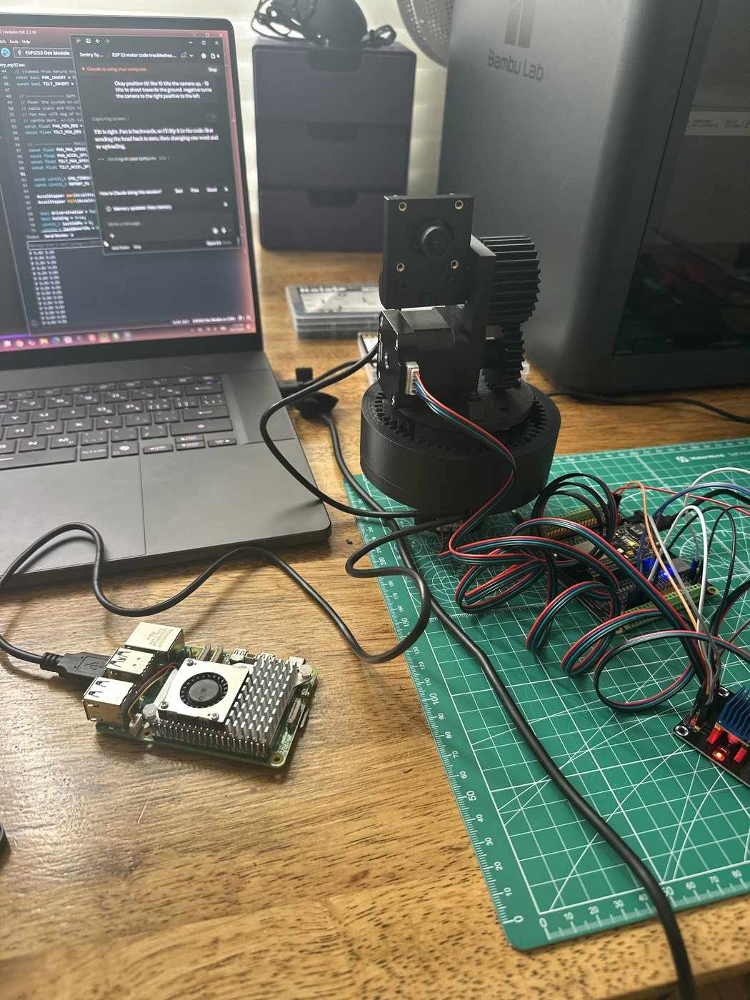
  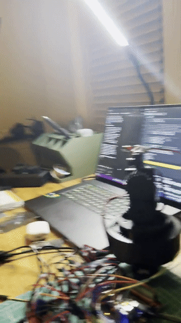
</p>

Full video: [media/demo.mp4](media/demo.mp4)

## Status

Assembly and initial testing are done. I'm now on final testing, tuning and wiring.

- [x] CAD and printing
- [x] Planetary gearboxes built and tested
- [x] Full assembly
- [x] Initial testing: steppers, Pi to ESP32 link, face tracking, laser aim
- [ ] Final testing and tuning
- [ ] Wiring schematic in KiCad
- [ ] Tidy up the wiring and mount the electronics

## How it works

```
USB webcam -> Raspberry Pi 5 -> USB serial -> ESP32-S3 -> 2x TMC2208 -> 2x NEMA 17 + planetary gearboxes
                   |
                   +-> web page (live feed + detections)
```

**Raspberry Pi 5.** Python and OpenCV. YuNet finds faces and SFace checks whether the face is mine. The Pi works out the angles to the target, finds the laser dot in the frame to correct its aim, and sends speed commands to the ESP32. It runs at about 30 fps, with roughly 10 ms of processing per frame. The tracker starts on boot as a service.

**ESP32-S3.** It handles all of the real-time motion: speed ramping, soft limits (pan ±125°, tilt -20° to +30°), and a watchdog that stops the motors if the Pi goes quiet for 500 ms. It also drives the laser with PWM. The laser turns off by itself unless the Pi keeps telling it to stay on.

**Web page.** The Pi serves the camera feed with the face boxes, confidence scores and aim point drawn on top. I open it from a browser on any device on the network.

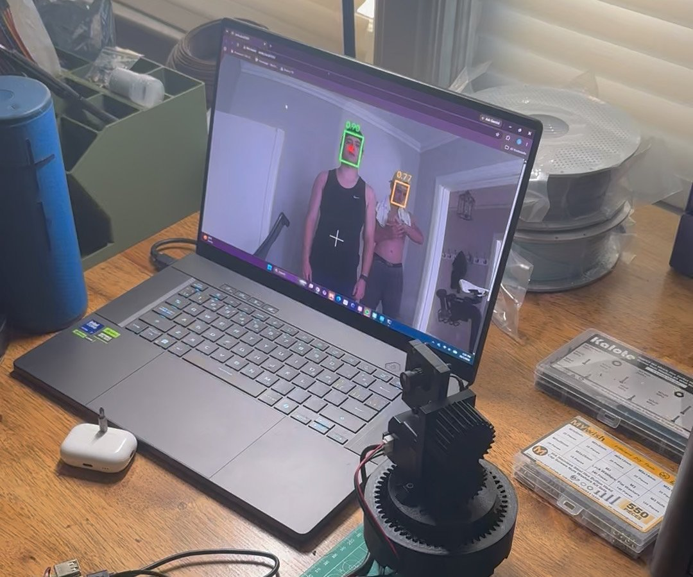

## Mechanical

Both axes are driven by NEMA 17 steppers through 3D-printed planetary gearboxes I designed: a sun, three planets, a ring and a carrier, with M3 screws as the planet pins. Tilt adds a spur gear pair up to the head. I modelled it in Onshape and printed everything in Bambu PLA Tough+, with M3 heat-set inserts wherever screws go into plastic.

<table>
  <tr>
    <td align="center">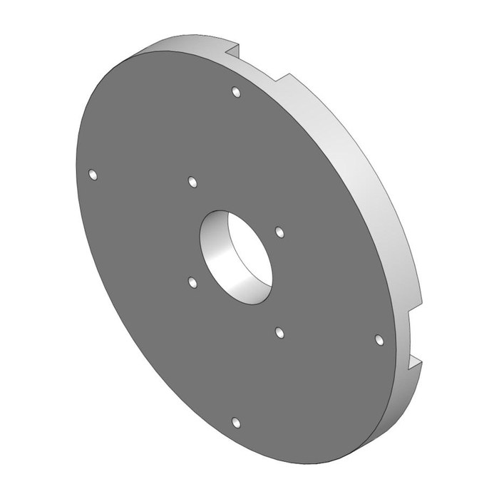<br>Base plate</td>
    <td align="center">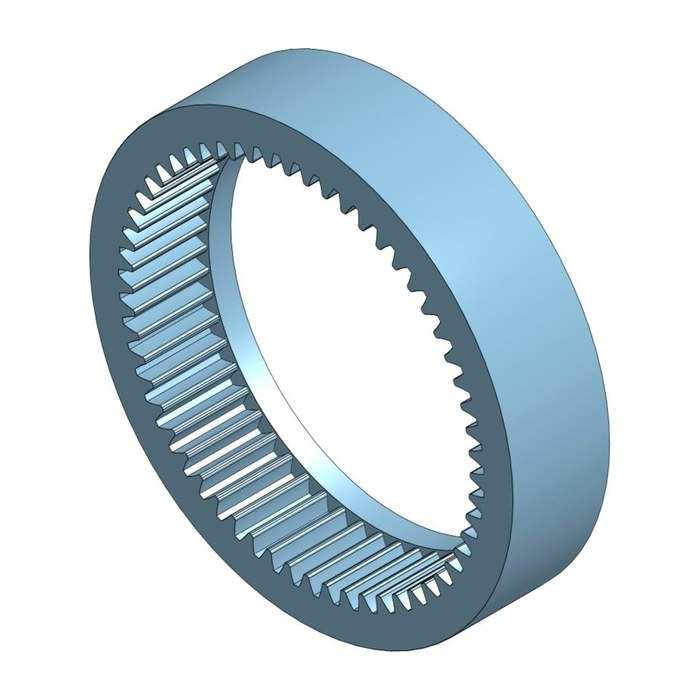<br>Ring gear</td>
    <td align="center">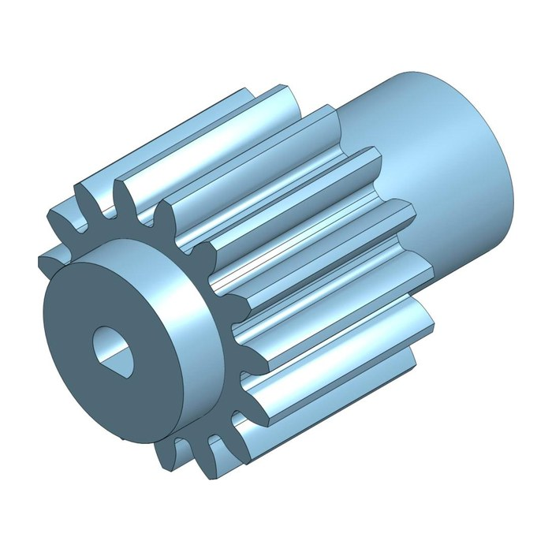<br>Sun gear</td>
    <td align="center">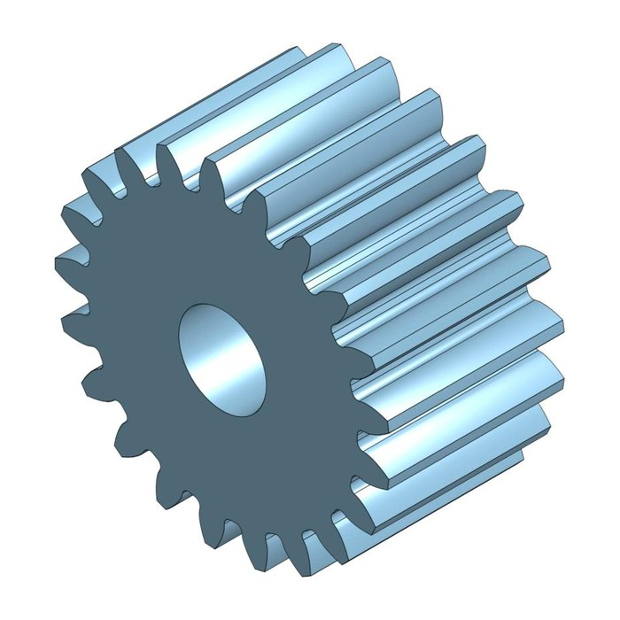<br>Planet gear (x3)</td>
    <td align="center">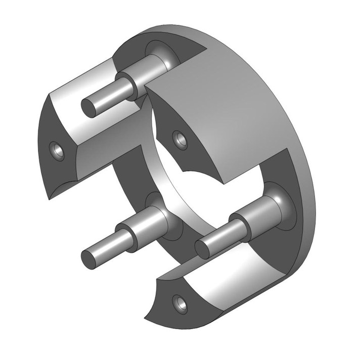<br>Planet carrier</td>
  </tr>
  <tr>
    <td align="center">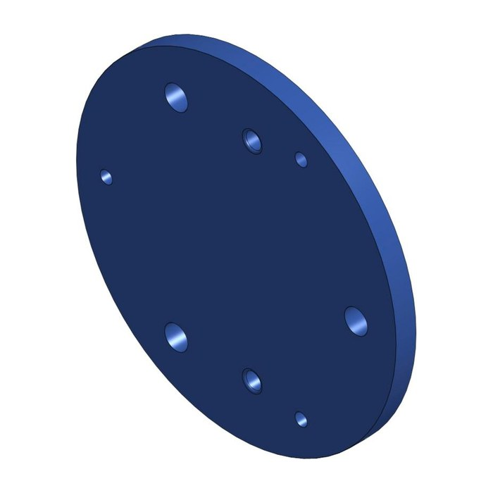<br>Top plate</td>
    <td align="center">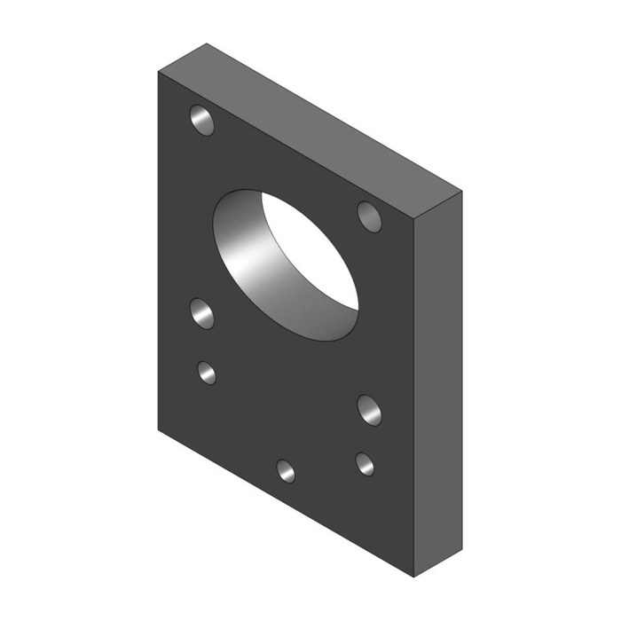<br>Motor plate</td>
    <td align="center">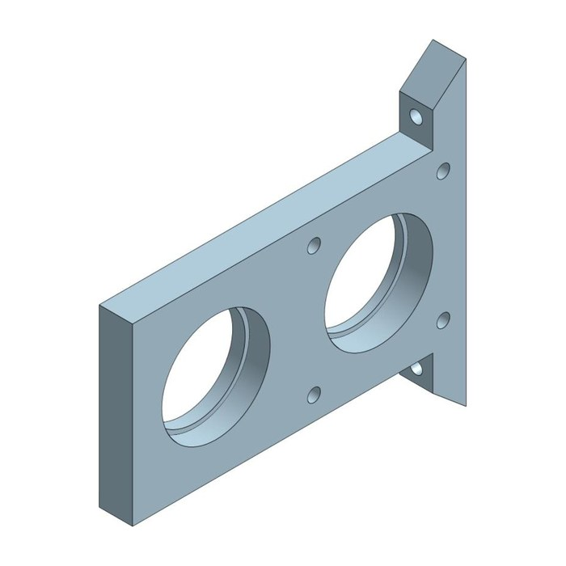<br>Tilt bracket</td>
    <td align="center">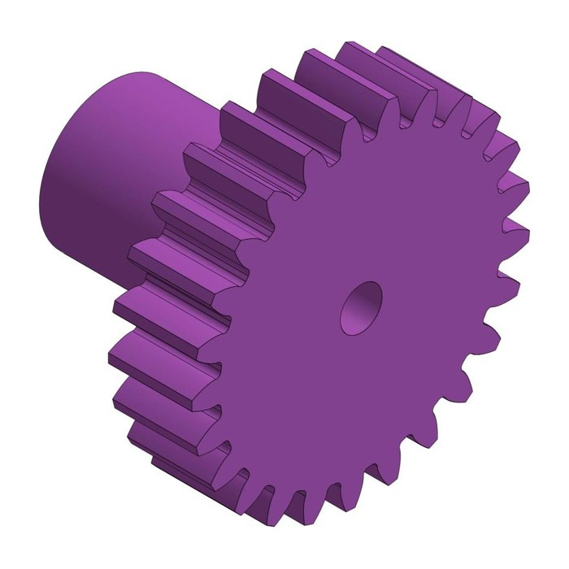<br>Tilt drive gear</td>
    <td align="center">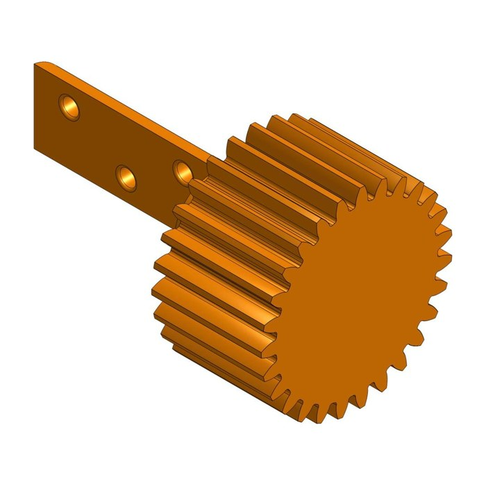<br>Tilt gear + arm</td>
  </tr>
</table>

## Parts

| Part | Notes |
|---|---|
| Raspberry Pi 5 (4 GB) | Vision and web server, official 27 W supply |
| ESP32-S3 on a Freenove breakout | Motion control |
| 2x NEMA 17 steppers | Pan and tilt |
| 2x TMC2208 drivers | 1/8 microstepping, about 0.9 A per motor |
| 24 V supply | Motor power |
| USB webcam | 640x480 MJPG at 30 fps |
| KY-008 laser module | 650 nm, 5 mW |
| Bearings | 6808 (40x52x7) and 6x10x3 mm |
| Hardware | M3 heat-set inserts (M3x4, 5 mm OD), M3 screws |

## Wiring

A proper KiCad schematic is coming. For now, here's the pin map:

| ESP32-S3 pin | Goes to |
|---|---|
| GPIO4 / 5 / 6 | Pan STEP / DIR / EN |
| GPIO7 / 15 / 16 | Tilt STEP / DIR / EN |
| GPIO17 | Laser signal |
| 3V3 | Driver logic (VIO) on both boards |
| GND | Shared ground |
| USB | Pi 5 (power and serial, 115200 baud) |

The 24 V supply is split to both driver boards. The Pi runs on its own USB-C supply.

## Laser safety

It's a 5 mW pointer, but it's still a laser pointed at people. The tracker aims at the upper chest, and the laser shuts off whenever the beam gets near any face in the frame. It also shuts off if the Pi stops talking to the ESP32.

## Code

The firmware and Pi code will go up once I move them over from my other laptop.
